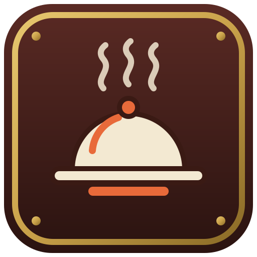
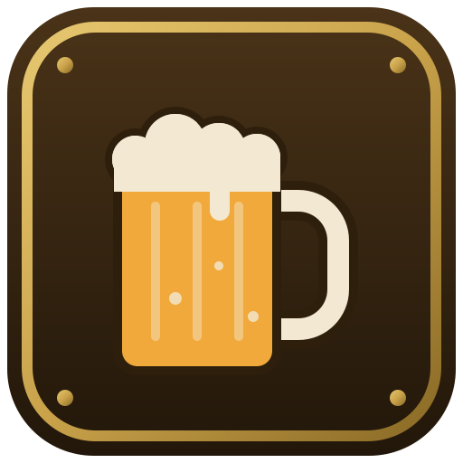

# Servus mod family

[](https://github.com/Dirnei/servus_mc_mods/actions/workflows/build.yml)
[](https://dirnei.github.io/servus_mc_mods/)
[](https://www.minecraft.net)
[](https://neoforged.net)
[](LICENSE)

NeoForge mods for Minecraft 26.1.2.

| | Mod | | Release |
|---|---|---|---|
|  | **Servus: Foundation** | The base: one Utility Duct for items, power, fluids and data, plus tanks, pumps, a generator and tools. | [](https://github.com/Dirnei/servus_mc_mods/releases?q=foundation-v) |
|  | **Servus: Alchemy** | Alchemy after Paracelsus: Salt, Sulfur and Mercury, gnomes that grow ore veins, a salamander from the Nether. | [](https://github.com/Dirnei/servus_mc_mods/releases?q=alchemy-v) |
|  | **Servus: Shuttles** | A warehouse run by shuttles on rails: storage, autocrafting, field farming and outposts. | [](https://github.com/Dirnei/servus_mc_mods/releases?q=shuttles-v) |
|  | **Servus: Delicacies** | An alcohol free Bavarian kitchen: Pretzels, dumplings, roast pork and a tiled stove. | not released yet |
|  | **Servus: Brewery** | Bavarian beer from the field to the glass: barley, hops, a brewhouse and casks. Needs Delicacies. | not released yet |

## Build

```
gradlew build
```

Needs a JDK 21; the jars land in `<mod>/build/libs`.

## License

MIT, see `LICENSE`.
