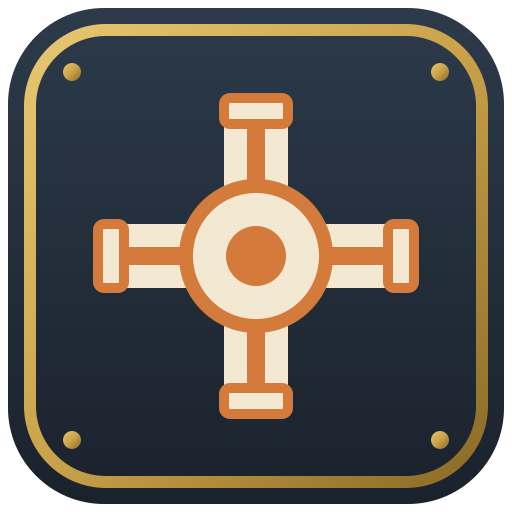

**Version 0.4.0.** Mod id `servus_foundation`. Needs nothing but NeoForge.

Foundation is the base of the Servus family. Shuttles and Alchemy both need it. It brings the transport blocks every base needs, a handful of utility machines, and the shared tools and rules that make all Servus blocks work the same way. It also works on its own as a small pipes and utilities mod.

## Tools

- **Configuration Carrot**: the wrench of the family. Use it on a face to change that side. Sneak use it to pick up a block and keep its settings. On a duct it opens the side settings of that arm.
- **Engineer Goggles**: worn on your head. They show side settings and ducts hidden behind facades.
- **Data Potato**: shows how busy the data line is. Use it on a duct, a tank or a Servus storage block for a short report in chat.

## The Utility Duct

One block that carries up to four lines side by side:

| Item | Line | Moves |
|---|---|---|
| Item Pipe | orange | items |
| Power Cable | red | FE |
| Fluid Pipe | blue | fluids |
| Data Cable | white, gray or black by tier | links machines for autocrafting |

Use a line item to place a duct, or use it on a duct to add that line. Each line forms its own network. Ducts work with any block of any mod that offers the standard NeoForge item, energy or fluid capability.

Use the Configuration Carrot on an arm that touches a machine or chest to open its side settings. Each line has a mode per side (in and out, pull in, push out or off) and a channel. Things only move between sides on the same channel. Channels have names, colours and icons, and your team shares them. The Item Pipe also has filter slots and a priority per side.

Ducts can stand in water. **Facades** hide a duct behind the look of any full block: craft a block with a nugget to get six. A facade closes its face. A **Hollow Facade** (eight facades in a ring) covers the face but lets the duct through.

### The data line

The data line moves nothing by itself. It links blocks that make or hold items, so a Shuttles warehouse and its Crafting CPU can find them without setup. It comes in three tiers:

| Cable | Items per second | Directions |
|---|---|---|
| Data Cable | 32 | shared by both directions |
| Duplex Data Cable | 32 | 32 each way |
| Fast Data Cable | 128 | 128 each way |

Use a higher tier cable on a duct to upgrade it in place. Right click a data duct with an empty hand to see its network and its load. Other mods can join the data line; see the [developer guide](/servus_mc_mods/developers/).

## Fluid Tank

A glass tank with a copper frame. Tanks that touch and fill a whole box become one big tank. Buckets work on every face. The block you craft into its bottom becomes the tank's floor.

## Machines

All machines face you when placed, open a screen on right click and keep their settings when you pick them up with the carrot.

- **Coal Generator**: burns furnace fuel into 40 FE per tick. It stops when its buffer is full and starts again below half.
- **Burner Pump** and **Electric Pump**: stand on an infinite water source and fill a buffer without using the water up. The Burner Pump burns fuel, the Electric Pump runs on FE.
- **Sink**: eight Sink blocks in a 2 by 2 by 2 cube, formed with the carrot. It voids items, fluids and FE. Chimney blocks on a top corner make it faster, and Capacity Upgrades give it a bigger buffer. Sink and Chimney take the look of the stone you craft them from.
- **Chimney**: also works alone as decoration. The carrot picks how much it smokes.
- **Ender Anchor**: keeps chunks loaded while it has FE. Anchor Upgrades make the area bigger, and each team has a cap on loaded chunks.
- **Mill**: grinds Gravel into Sand. It has no power of its own: hold right click on a **Hand Crank**, or put an **Electric Motor** against it. Datapacks can add more milling recipes.
- **Machine Adapter**: puts a furnace, smoker or blast furnace on the data line, so a Crafting CPU can smelt with it. See [Machine Adapter](/servus_mc_mods/developers/machine-adapter/).

## Upgrades

- **Speed Upgrade**: doubles the rate of a block with upgrade slots, such as the Packing Station or the Electric Motor.
- **Capacity Upgrade**: gives a block more room, such as the Sink or the Fluid Gantry.
- **Anchor Upgrade**: makes the Ender Anchor's area bigger and lets a Shuttles warehouse site wake up.

## Side settings

Every Servus machine has the same side panel in its screen. Each side can be Auto, Input, Output, Both, Pull, Push or Off, relative to the block's front, so the settings survive turning it. Blocks with several tanks also have a Fluids layer, where a side can be tied to one tank. Right click the air with the carrot to switch it between the Items and Fluids layer.

## Config

`config/servus_foundation-common.toml` holds, among others, the team chunk cap of the Ender Anchor (`maxLoadedChunksPerTeam`), whether anchors give way to FTB Chunks (`enderAnchorRespectsFtbChunks`) and whether the carrot may turn blocks of other mods (`wrenchRotatesBlocks`).
