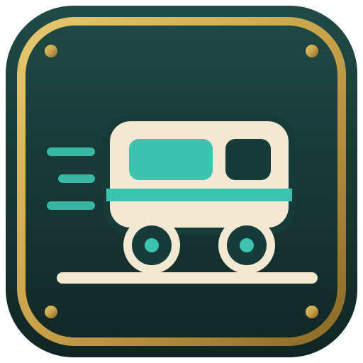

import ModInfo from '../../../components/ModInfo.astro';

Shuttles lets you build a real warehouse. There are no storage disks: items sit in racks you can see, rails link the racks, and small shuttles drive along the rails to fetch and put away. Every pick and every put-away rides a shuttle, so a good layout is a fast warehouse.

## Your first warehouse

You need five things, all crafted from vanilla materials:

1. **Heavy Duty Rack**: a shelf of 27 slots. Racks in a row join into sections.
2. **Warehouse Rail**: lay it in front of the racks. Rails link everything they touch into one warehouse.
3. **Shuttle Garage**: place it beside the rail. It holds up to four shuttles.
4. **Shuttle Mk1**: put it into the garage.
5. **Warehouse Controller**: one per warehouse brings it online. Feed it FE, for example from a Foundation Coal Generator. The whole warehouse runs on the controller's power.

Then add a way in and a way out:

- **Inbound Station**: on the rail. Hoppers and pipes fill it, and shuttles put its items away.
- **Outbound Station**: on the rail. Set keep amounts, and shuttles keep it stocked. It pushes into the machine next to it.
- **Storage Terminal**: search your stock, request items and hand items in. It sits on a Foundation data line, together with a **Packing Station** on the rail. The Packing Station is the door between the warehouse and the data line.

## More of the warehouse

- **Rail Elevator**: a shaft that carries shuttles between floors. Speed Upgrades make its car faster.
- **Zone Label**: name a zone and give it item filters, then stamp it onto racks. Put-aways go to matching racks first.
- **Shuttle Workshop**: builds a Mk1 shuttle into a Mk2 and a Mk2 into a Mk3. Higher tiers carry more stacks per trip. Here you also fit Speed Upgrades, Handling Upgrades and one tool.
- **Stock rules**: in the Storage Terminal, set a minimum and a maximum for an item. When the stock drops below the minimum, the warehouse orders more from a Crafting CPU.
- **Sites**: every controller is a site with a name. With **Anchor Upgrades** a far away site can wake up for a transfer. With a **Wireless Upgrade** and FE, sites of your team in the same dimension trade with each other, and the Storage Terminal can request from them.

## Autocrafting

Autocrafting runs over the Foundation data line. Machines on the line report what they can make, and a CPU plans the steps.

- **Crafting CPU** and **CPU Buffer**: blocks that form a box of at least 2 by 2 by 2 with the Configuration Carrot. More CPU blocks run more orders at once. Buffer blocks hold the in-between items.
- **Crafting Station**: makes vanilla crafting recipes for the CPU.
- **Pattern Storage**: keeps crafting patterns as data, not as items.
- **Production Terminal**: write patterns, and watch jobs, machines, CPUs and how full your storage is.

Request something in the Storage Terminal that is not in stock, and the CPU crafts it. Alchemy machines and a furnace behind a Foundation Machine Adapter can be producers too.

## Fields

A field is farmland along a run of **Farm Rail**, served by a **Field Head** at its side. The Field Head waters the field, tracks which crops are ripe and keeps a small buffer of seeds and fertilizer. A **Range Upgrade** makes the field wider. Farm rail is copper and corrodes with use unless the head has an anti-corrosion item.

Tool modules turn a shuttle into a field worker. Fit them in the Shuttle Workshop:

- **Harvester**: harvests ripe crops, tills and replants, and brings the harvest home.
- **Spreader**: spreads fertilizer from the Field Head's buffer.

Plain shuttles keep the Field Head's buffer stocked.

## Fluids

- **Fluid Gantry**: a frame over a straight rail with two tanks. It stores fluids, takes them in from pipes, or gives them out, set in its screen. Capacity Upgrades make the tanks bigger.
- **Tanker**: a tool module that makes a shuttle carry fluids between gantries.

## Numbers

Rates, slot counts, speeds and travel times live in datapack JSON under `data/<namespace>/shuttles/` (`warehouse.json`, `shuttle.json`, `rack.json`, `field.json`, `gantry.json`, `cpu.json` and more). A modpack may have changed them.

## Mod info

<ModInfo version="0.4.0" modId="servus_shuttles" tag="shuttles-v0.4.0" requires={[{ name: 'Servus: Foundation', version: '0.4.0 or newer', href: '/mods/foundation/' }]} />
